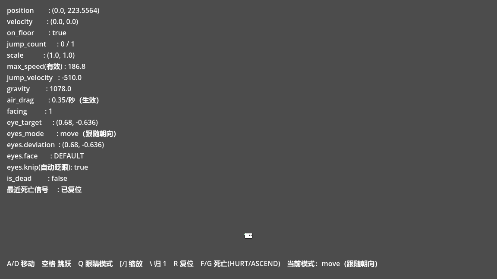
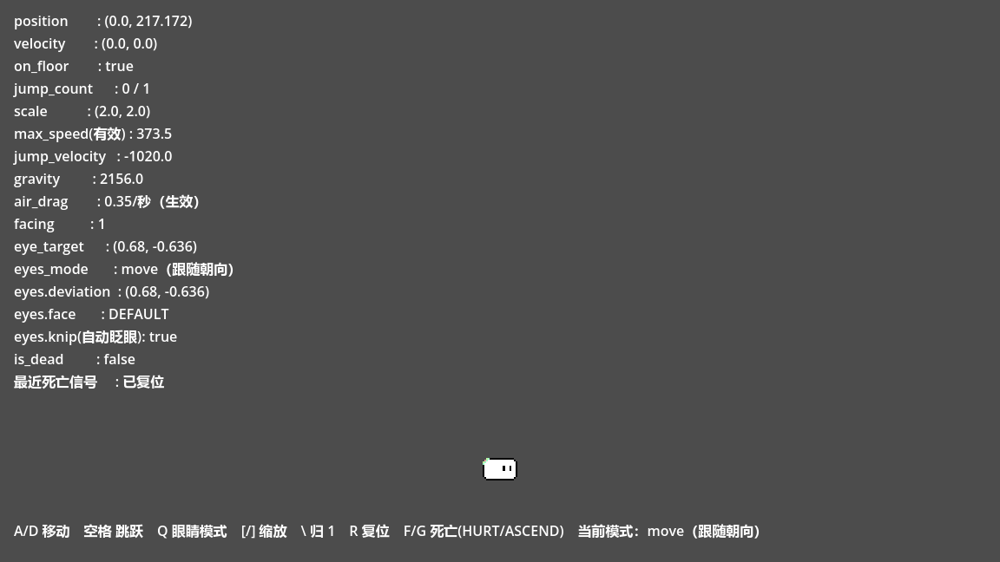

# player_system —— 玩家实例独立子系统

从 `L:\游戏项目\jump!`（项目名「梦与日记」）中剥离出来的玩家实例子系统，
现已可在本项目（`L:\项目\测试`）中独立运行、独立测试，不依赖 jump! 的任何其它脚本或资源。

剥离目标：让「玩家的一举一动」（移动 / 跳跃 / 眼睛 / 受伤与死亡表现）成为一个
**自带素材、自带场景、自带测试、边界清晰**的模块，便于单独迭代与回归，也便于日后回灌。

---

## 1. 目录结构

```
player_system/
├── README.md                      本文件
├── docs/
│   ├── IMPROVEMENT_PLAN.md        改进方案（现状诊断 + 分阶段改造 + 验收标准）
│   ├── screenshot_sandbox.png     沙盒实拍（scale = 1）
│   └── screenshot_sandbox_scale2.png  沙盒实拍（scale = 2，验证缩放补偿）
├── scripts/                       ← 剥离物：脚本（与源项目逐字节一致）
│   ├── player.gd                  CharacterBody2D 玩家：移动、跳跃、眼睛调度、死亡
│   ├── player.gd.uid
│   ├── eye.gd                     像素眼睛：偏移插值、瞄准、眨眼、表情
│   └── eye.gd.uid
├── scenes/                        ← 剥离物：场景
│   ├── player.tscn                player 根 + CollisionShape2D + player(Sprite2D) + eyes 实例
│   │                              + DeathAnimation（空的扩展点）。
│   │                              ⚠ 已移除：smoke(28 帧 SpriteFrames) / WorldEnvironment /
│   │                                预制死亡动画(god·split·steve·steve_deal) / AudioStreamPlayer
│   └── eyes.tscn                  eyes 根 + TextureRect + AnimationPlayer(chiler) + Timer（仅 D1 数据修复）
├── assets/                        ← 剥离物：素材
│   ├── player/player.png          玩家本体贴图 20×13
│   ├── player/eyes2-1.png         眼睛图集 32×32
│   ├── fx/mist_01..28.png         Steve 死亡烟雾 28 帧（1440×1080）
│   └── audio/
│       ├── 我的世界玩家受伤.ogg      受伤音效
│       ├── 天堂光芒_爱给网_aigei_com.mp3  god 分支长音
│       └── 我的世界 经验球 升级.ogg     死亡结算音效
├── demo/                          ← 新增物：可运行沙盒
│   ├── player_sandbox.tscn
│   └── player_sandbox.gd
├── tests/                         ← 新增物：无头冒烟测试
│   ├── player_smoke_test.tscn
│   └── player_smoke_test.gd
└── tools/                         ← 新增物：剥离与导入辅助
    ├── extract_player_system.py  可复现的剥离脚本（幂等）
    └── sync_import_cache.gd      无编辑器环境下同步导入缓存
```

---

## 2. 与源项目的路径对照

| 源项目（jump!） | 本子系统 |
| --- | --- |
| `res://scipts/player/player.gd` | `res://player_system/scripts/player.gd` |
| `res://scipts/player/eye.gd` | `res://player_system/scripts/eye.gd` |
| `res://scenes/player/player.tscn` | `res://player_system/scenes/player.tscn` |
| `res://scenes/player/eyes.tscn` | `res://player_system/scenes/eyes.tscn` |
| `res://assets/player/*` | `res://player_system/assets/player/*` |
| `res://assets/steve_anim/mist_*.png` | `res://player_system/assets/fx/mist_*.png` |
| `res://assets/FIX/*` | `res://player_system/assets/audio/*` |

两点刻意为之：

1. **脚本保持保真基线**：`player.gd` 在缩放补偿与空中阻力两处做过**功能**改动（见 §5、§6）；
   `eye.gd` 与 `player.gd` 另外各自加了**注释**（D2、D5 的已知限制说明，可执行代码逐行未动，见 §11、§12）；
   还有一处纯数据修复在 `eyes.tscn`（见 §8「眨眼时眼睛消失」）。
   除此之外的其它问题都原样保留，改进方案里的每一项都能与之对照。
   （`tools/extract_player_system.py` 已把这两个脚本登记为 `LOCALLY_MODIFIED`，
   重跑不会覆盖它们，而是把源版本另存为 `*.from_source` 供 diff。）
2. **uid 全部保留**（`uid://q6asbxlf23qt` 等）。场景之间的 `ext_resource uid=` 引用、
   `.import` 里的资源 uid 都与源项目一致，既保证内部引用不破，也方便日后做双向 diff/回灌。

---

## 3. 依赖边界（接入到别的项目时必须满足）

| 依赖 | 位置 | 说明 |
| --- | --- | --- |
| 输入动作 `move_left` / `move_right` / `jump` | `project.godot [input]` | 已自源项目原样迁移（A/D/空格 + 手柄左摇杆/下键） |
| `physics/2d/default_gravity` | `project.godot [physics]` | 未显式设置，用 Godot 默认 980；`player.gd` 取它 ×1.1 |
| `rendering/textures/canvas_textures/default_texture_filter=0` | `project.godot [rendering]` | **必须为 0（Nearest）**，否则像素眼睛/玩家会被线性插值糊掉 |
| 渲染器 | `rendering/renderer/rendering_method` | 玩家已**不再引用任何 Environment**（D9），所以渲染器对玩家没有额外要求 |
| 节点路径约定 | `player.tscn` 内部 | `$CollisionShape2D`、`$player`（Sprite2D 贴图）、`$player/eyes`、`$DeathAnimation`（可选扩展点）。`eyes.body` 指向 `$player`，改名会破坏这个引用 |
| 死亡表现 | 无（已移出） | 玩家不再需要烟雾 / 音效 / 后处理；表现层只需接 `player.died` 信号 |
| 父节点类型 | 玩家所在父节点 | `eyes_mode = look_at` 时会调用 `get_parent().get_local_mouse_position()`，**父节点必须是 `CanvasItem`（如 Node2D）** |

---

## 4. 怎么跑

### 4.1 可视化沙盒

```
godot --path "L:\项目\测试" player_system/demo/player_sandbox.tscn
```

或用 DSH 的 `godot_run_project(scene="player_system/demo/player_sandbox.tscn")`。

操作：`A/D` 移动，`空格` 跳跃，`Q` 切换眼睛模式，`[` `]` 缩放玩家，`\` 缩放归 1，
`R` 复位，`F` / `G` 分别触发 `die(HURT)` / `die(ASCEND)`。

> `F`/`G` 只让玩家置位死亡状态并广播信号 —— 玩家本身**没有任何死亡表现**，
> 沙盒把收到的 `died(kind)` 打到屏幕上，演示"表现交给外部"（§13.2）。

`scale = (1,1)`（左）与 `scale = (2,2)`（右）：玩家变大两倍，有效速度参数同步翻倍。

|  |  |
| --- | --- |
| `max_speed 186.8` / `jump_velocity -510.0` / `gravity 1078.0` | `max_speed 373.5` / `jump_velocity -1020.0` / `gravity 2156.0` |

### 4.2 无头冒烟测试（136 条断言）

```
godot --headless --path "L:\项目\测试" player_system/tests/player_smoke_test.tscn
```

全部通过退出码 0，任一断言失败退出码 1。覆盖：

1. 场景装配：脚本挂载 / 贴图与图集解析；**D14**（玩家场景无 `AnimatedSprite2D`、烟雾与受伤音效不进资源缓存、
   素材仍在素材库）；**D9**（子树里没有任何 `WorldEnvironment`）；**D11**（`DeathAnimation` 存在且为空、
   旧 `deal()`/`_on_button_button_up()` 已移除、新信号与 API 已暴露）；**D13**（新旧命名）；
   **D12**（反射遍历 `get_property_list()` 断言 15 个参数都带 `PROPERTY_USAGE_EDITOR`）
2. 重力落地（240 物理帧内落到地板顶面附近、落地垂直速度归零）
3. 地面眼睛状态（自动眨眼开、表情 DEFAULT）
4. 水平移动（速度方向、位移、`max_speed` 钳制、眼睛偏移随朝向翻转、松手摩擦衰减）
5. 跳跃（起跳速度、跳跃计数、离地、空中禁二段跳、落地计数重置）
6. 空中眼睛状态（关自动眨眼、表情切 BLINK、落地恢复）
7. 眼睛表情与眨眼动画：四个表情区域、**D7 幂等性用行为直接验证**（把 region 人为改坏 → 同表情再调一次
   必须原样保留；换表情时必须重写；`set_knip` 不再动表情）、**D1 回归**（逐帧扫描一次眨眼，
   `TextureRect.texture` 全程不为 null）、偏移钳制、两种模式切换
8. 玩家缩放对运动的影响（缩放线性放大三项参数、跳跃高度线性 / 滞空不变 /
   「几个自己那么高」不变、缩回还原、`scale_affects_motion=false` 无效、`motion_scale` 独立可调、负缩放不反向）
9. 空中阻力（原地起跳保留 100% / 非原地起跳保留 75%、朝向反方向、身后滑不介入、静止不飘、
   朝向翻转方向同步、`air_drag=0` 关闭、落地复位）
10. 死亡与复位：`die()` 幂等且 `died` 恰好一次、死亡冻结物理、死亡时眼睛锁 BLINK、
    **扩展点可用**（往 `DeathAnimation` 加一个同名动画后 `die()` 会自动播放，并验证移除后恢复为空）、
    `respawn_at()` 逐项清状态、`respawn()` 回出生点、`respawned` 信号、`freeze_on_death` 开关

> · 第 8 组起改为**动态读取基准值**（不再写死 435/‑900 之类的具体数字），
>   因此在 `player.gd` 里调 `max_speed` / `jump_velocity` 不会让测试失败。
> · 测试带**完整性哨兵**：如果某段脚本错误让协程中断、用例没跑完，会直接判失败并返回退出码 1，
>   而不是只汇总"已经跑过的那部分"（这个坑真的踩过，见 `docs/IMPROVEMENT_PLAN.md` §1.9 末段）。

11. 初始化幂等（**D5 回归**：重复 `_ready()` 不再叠乘、不覆盖出生点）+
    `ground_friction` 真的接在地面分支上（1.0 不减速 / 0.2 迅速刹停），默认值等于原字面量 0.83

### 4.3 在别处重新导入

**正常流程**：用 Godot 编辑器打开本项目一次即可，编辑器会自动导入素材并重建 uid 缓存
（当前无头运行会打印 35 条 `ext_resource, invalid UID ... using text path instead` 警告，
只是 uid 缓存尚未建立，不影响运行，编辑器打开一次后消失）。

**无编辑器 / 受限沙箱环境**：先用剥离脚本搬运文件，再用 `sync_import_cache.gd` 搬运导入缓存：

```powershell
python player_system/tools/extract_player_system.py      # 幂等，可重复执行
```

```
# 通过 godot_headless_op 覆盖 ops_script（Godot 进程不受文件沙箱约束）
godot --headless --path "L:\项目\测试" `
      --script res://player_system/tools/sync_import_cache.gd `
      sync_import_cache '{"source_project":"L:/游戏项目/jump!","assets_dir":"res://player_system/assets"}'
```

> 为什么需要它：Godot 的独立运行时（非编辑器）**不会重新导入资源**，只读 `.godot/imported/` 既有缓存；
> 而 DSH 文件沙箱不允许代理进程写 `.godot/`。缓存与源文件字节绑定，搬运是自洽的。

---

## 5. 玩家缩放对运动的影响

### 5.1 问题

`CharacterBody2D.velocity` 的单位是「全局像素/秒」，**与节点 `scale` 无关**。
所以把玩家放大一倍，他会变大，但跑得跟原来一样快、跳得跟原来一样高、滞空时间也不变：

| | 体型 | 跑动速度 | 跳跃高度 | 跳跃高度 ÷ 身高 |
| --- | --- | --- | --- | --- |
| 未补偿 | ×2 | 不变 | 不变 | **减半**（跳不起自己那么高） |

### 5.2 做法

`player.gd` 新增两个参数，并按当前缩放重算运动参数（相当于把整段运动学一起缩放）：

```gdscript
@export var scale_affects_motion: bool = true   # 默认开启
@export var motion_scale: Vector2 = Vector2.ONE # 额外的运动倍率

max_speed     = _base_max_speed     * s.x   # 水平位移 / 自身宽度 不变
jump_velocity = _base_jump_velocity * s.y   # 起跳初速度（负值等比放大）
gravity       = _base_gravity       * s.y   # 滞空时间不随体型变化
```

- `s = scale.abs() * motion_scale`；取绝对值，**水平翻转（负缩放）不会把移动方向也反过来**。
- 基准值在 `decode_vector()` 里记下，来回缩放不会累积误差。
- `refresh_motion_scale()` 在 `_ready()` 与**每个物理帧**开头调用，缩放没变时立即返回，
  因此动画/技能驱动的运行时缩放也能被跟上。
- `scale = (1,1)` 时结果与改造前**完全一致**（冒烟测试已断言）。

### 5.3 实测效果（`scale` 1 → 2）

| 指标 | scale=1 | scale=2 |
| --- | --- | --- |
| `max_speed` | 435.0 | 870.0 |
| `jump_velocity` | -900.0 | -1800.0 |
| `gravity` | 1078.0 | 2156.0 |
| 跳跃高度（像素） | 368.2 px | 736.4 px（×2.00） |
| 滞空帧数 @60Hz | 99 | 99（不变） |
| 跳跃高度 ÷ 体型 | 368.2 | 368.2（不变） |

> ⚠️ 如果你用 `scale` 做「挤压拉伸（squash & stretch）」这类**纯视觉**动画，
> 请把 `scale_affects_motion` 关掉，改用 `motion_scale` 单独给运动倍率，
> 否则每一下挤压都会让移动速度跟着抖。

---

## 6. 空中阻力（朝向反方向 + 原地起跳例外）

### 6.1 问题

原实现里的 `air_resistance` 名义上是"空中水平阻力系数"，实际是 `current_velocity.x *= air_resistance`
—— 系数 1.1（后来被调到 1.4）意味着**每帧加速**，方向与名字完全相反；同时
`lerp(vx, ground_friction*(desired+velocity.x), …)` 里既混着 `0.7·vx` 这个阻力项，
又把 `ground_friction` 当成目标速度的系数，导致**空中按住方向键反而减速**
（平衡速度只有 `0.237/0.763 × max_speed` ≈ 58，而 `max_speed` 是 186.8）。

### 6.2 现在的规则

```gdscript
@export var air_drag: float = 0.35        # 每秒沿朝向轴衰减掉的比例
@export var air_control: float = 0.35     # 空中操控力（每帧拉向输入目标速度的比例）
@export var in_place_epsilon: float = 0.01
```

1. **方向恒为「玩家朝向」的反方向**（`facing`，原 `player_direction`）：朝向右侧时阻力向左，朝向左侧时向右。
   不是简单地与速度相反 —— 朝向翻转时阻力方向**同步翻转**（朝向轴上的投影：`along = vx × facing`）。
2. **只削减「朝向前方」的那部分动量**：`along <= 0`（在往身后滑）或静止时直接返回。
   阻力**不会把玩家推向后方**，也**不会让静止的滞空玩家自己飘起来**。
3. **原地起跳例外**：起跳那一帧的水平输入 ≤ `in_place_epsilon` → 判定为原地起跳，
   **整段滞空都不施加阻力**，起跳时的水平速度原样保持到落地或重新输入。
   判定放在 `move_and_slide()` 之后，用刚翻转的 `is_on_floor()` 检测"刚离地那一帧"。
4. 数值帧率无关：每帧乘以 `pow(1.0 - air_drag, delta)`；`0.35` 表示一秒后还剩 65%。

### 6.3 实测（`air_drag = 0.35`，40 个物理帧 ≈ 0.667 s）

| 场景 | 水平速度 | 结果 |
| --- | --- | --- |
| 起跳瞬间按住方向（阻力生效） | 186.8 → 140.1 | 保留 **75%**（理论 0.65^0.667 = 0.752） |
| 起跳瞬间无输入（原地起跳，忽略阻力） | 106.8 → 106.8 | 保留 **100%** |
| 朝向右侧、向右移动（朝向前方） | 100 → 80.6 | 被削减 ✓ |
| 朝向右侧、向左移动（往身后滑） | -100 → -100.0 | 阻力不介入，不会被推向后方 ✓ |
| 朝向右侧、静止 | 0 → 0.00 | 不会自己飘起来 ✓ |
| 朝向左侧、向左移动（朝向前方） | -100 → -80.6 | 方向随朝向同步翻转 ✓ |
| `air_drag = 0` | 100 → 100.0 | 完全不衰减 ✓ |

> ⚠️ **两个需要你确认的点**：
> 1. `air_drag = 0.35/秒` 是我选的默认值（原来的"阻力"是 +2.6%/帧的加速、更早的版本是 −1.55%/帧）。
>    想更强就调大（0.5 ≈ 一秒后剩 50%），想更弱就调小，`0` 即关闭。
> 2. `ground_friction = 0.237` **目前对地面摩擦没有任何影响** —— 地面分支用的是硬编码字面量
>    `current_velocity.x *= 0.83`。这个值以前被误用在空中公式里，现在空中不再引用它。
>    要不要把地面摩擦也接到 `ground_friction` 上？（接上会让地面减速从 0.83/帧 变成 0.237/帧，差别很大，所以我没有擅自改。）

---

## 8. 眨眼时眼睛消失（D1，已修复）

### 8.1 症状与逐帧实测

`chiler` 的眼部贴图轨道是**离散**轨道（`update = 1`，值会一直保持到下一个键），
末帧的值被写成了 `null`。逐帧采样一次完整眨眼：

| 帧 | 显示 | `TextureRect.position.y` |
| --- | --- | --- |
| f00–f02 | 睁眼 `\| \|` | 1.26 |
| **f03–f05** | **NULL（整只眼睛没有贴图）** | 1.26 → 1.00 |
| f06–f07 | 闭眼 `- -` | 0.85 → 0.69 |
| f08–f11 | 半闭（2px 短竖） | 0.54 → 0.15 |
| f12+ | 睁眼 `\| \|` | 0 |

即**每次眨眼都有连续 3 帧（≈50 ms）眼睛完全消失**。源码里的
`play("chiler")` 紧跟 `play_backwards("chiler")` 只掩盖了「动画结束后永久不可见」，
掩盖不了中途这 3 帧。

### 8.2 眼睛图集区域对照（`eyes2-1.png`，32×32；`#`=不透明，`.`=透明）

```
    00000000001111111111222222222233
    01234567890123456789012345678901
 2  ..#..#..........................   default    (0, 2,8,3)    | |   睁
 3  ..#..#....#..#..................   chiler#2   (8, 2,8,3)    | |   半闭（高 2px）
 4  ..#..#....#..#....#..#..........   chiler#3   (16,12,10,3)   - -   闭
 7  ..#..#....#..#..................   blink_left (8, 7,8,3)    X     挤眼
 8  ..#.#......#.#..................
 9  ..#..#....#..#..................   blink_right(0, 7,8,3)    X     挤眼（镜像）
12  ..#...#...#...#.................   blink      (0,12,9,3)    X     挤眼（宽）
13  ...#.#.....#.#..................
14  ..#...#...#...#.................
24  .#.#.#.#........................   die        (0,24,9,3)    X X   死亡
25  ..#...#.........................
26  .#.#.#.#.........................
```

### 8.3 修复

`scenes/eyes.tscn`，`chiler` 的 `tracks/0`（`TextureRect:texture`）末帧值一行改动：

```diff
-"values": [SubResource("AtlasTexture_c6fh2"), SubResource("AtlasTexture_i4qtv"), SubResource("AtlasTexture_7sjra"), null]
+"values": [SubResource("AtlasTexture_c6fh2"), SubResource("AtlasTexture_i4qtv"), SubResource("AtlasTexture_7sjra"), SubResource("AtlasTexture_c6fh2")]
```

因为动画是**反向播放**的，这个键实际对应"眨眼开始前的保持帧"，
换成睁眼图集后序列变成 **睁眼（保持）→ 闭眼 → 半闭 → 睁眼**：
`null 帧数` 从 **3 → 0**，位置轨道依旧回到 `0`，
`TextureRect.texture` 结束后仍等于脚本缓存的图集（`set_expression` 继续有效）。

### 8.4 回归

`tests/player_smoke_test.gd` 第 [7] 组新增 4 条断言，逐帧扫描一次完整眨眼：

- `TextureRect.texture` **全程不为 `null`**（实测 0 帧）
- 过程中确实切换了 ≥3 种图集区域 —— 否则"什么都不做"也能满足上一条
- 结束后贴图回到脚本缓存的图集 —— 否则 `set_expression` 会写到一个**没在显示**的资源上，表情静默失效
- 结束后表情仍可正常切换

> **没有改的部分 / 可选后续**：`eye.gd:88` 的 `play("chiler")` 紧跟 `play_backwards("chiler")`
> 导致动画**反向播放**。作者的键间距是 `0=睁 / 0.073=半闭 / 0.099=闭 / 0.147=末帧`，
> 闭眼那段留得最长（48 ms），本意应是"闭眼停一下"；反向播出来就变成"睁眼停得最久"。
> 若想改成正向播放，必须同时给位置轨道补一个 `t=0.158 → (0,0)` 的键把眼睛移回原位
> （否则眨眼后眼睛会永久低 1.26 px），并且会改变眨眼观感 —— 所以我没有擅自改。

---

## 9. 玩家实例的行为速查（剥离后的实测值）

| 量 | 代码默认 | 运行时实际值 | 说明 |
| --- | --- | --- | --- |
| `max_speed` | 124.5 | **186.75** | `_ready()` 里被 `decode_vector()` ×1.5；再乘 `motion_scale.x` |
| `jump_velocity` | -340.0 | **-510.0** | 同上 ×1.5；再乘 `motion_scale.y` |
| `gravity` | `default_gravity × 1.1` | 1078.0 | 每帧 `current_velocity.y += gravity*delta`；再乘 `motion_scale.y` |
| 实测跳跃高度 | — | ≈ 116 px | 实测值（离散积分），理论 `v²/2g` ≈ 121 px |
| 实测滞空 | — | 55 帧 @60Hz ≈ 0.92 s | 不随 `scale` 变化 |
| 空中阻力 | `air_drag = 0.35`/秒 | 沿 -朝向 | 原地起跳时整段忽略（见 §6） |
| 空中操控 | `air_control = 0.35` | — | 仅在有水平输入时生效，目标为 ±`max_speed` |
| 地面摩擦 | `ground_friction = 0.83` | 0.83/帧 | 已接上参数（原来是硬编码字面量，参数是死的） |
| `max_jumps` | 1 | 1 | 空中按跳无效（已测） |
| `coyote_time` | 0.07 | 0.07 | 落地时重置计时，离地后递减 |
| `jump_buffer_time` | 0.1 | 0.1 | 空中递减 |
| 眼睛可移动半幅 | — | x ∈ ±0.68、y ∈ ∓0.636（归一化） | `eye_offset` 初值；x 的符号由 `facing` 在取用时决定 |
| `facing` | 1 | ±1 | 1 = 右 / -1 = 左；原 `player_direction`（D13） |
| 眼睛物理可达偏移 | — | ≈ ±4.65 px / ±2.4 px | 受 `player.png` 20×13 与 `margin=(10.7,8.2)` 限制 |
| 眼睛插值速度 | — | `3.4 × delta`（≈0.057/帧） | `position.lerp`，帧率相关 |

> 表中数值会随 `player.gd` 里的调参变化；冒烟测试已改为**动态读取基准值**，不会因调参而失败。

---

## 10. 仍未解决的已知问题

D7 / D9 / D11 / D12 / D13 / D14 已在 §13 的重构中解决。下面是**仍然存在**的问题
（详见 `docs/IMPROVEMENT_PLAN.md`）：

- **D6（剩余部分）** `is_on_floor()` 的帧边界**语义**仍在（它由 `move_and_slide()` 更新，落地帧读到的是上一帧的值）。
  §14 已把主流程拆成 `_update_vertical()` / `_update_horizontal()` 并把 `grounded` 显式缓存，语义不再隐式，
  但**没有改变那个 1 帧延迟本身**（改它会动到手感）。彻底修需要把跳跃状态机整体重排（改进方案 P1-2）
- **D10** 输入直接轮询全局 `Input`（`_physics_process` / `_process` 各一次），无法脚本化 / AI 接管 / 录制回放
- **D15** 眼睛位移幅度从贴图尺寸推导，归一化 0.68 只对应 ≈3.2px
- **D16** 没有 `class_name`（刻意为之：全局类名在无编辑器的无头运行里解析不到，见 §13.3）
- **D2** 已按决定「只加注释、不改行为」，帧率相关的眼睛插值**依然存在**（见 §11）
- **D5（剩余部分）** 隐藏 ×1.5 **仍在**（`max_speed` 显示 124.5 → 运行时 186.75）。
  但**重复调用叠乘的雷已经拆掉** —— `_initialize()` 现在幂等，见 §12 / §14
- 死亡表现的**素材**（28 帧烟雾、3 段音频）仍在 `assets/` 里，虽然玩家场景不再加载它们，导入开销仍在

---

## 11. 眼睛插值速度与帧率相关（D2，已处置）

**处置方式：在代码注释里标注为已知限制，不改行为。**
（`eye.gd` 因此不再是"与源项目逐字节相同"，但**可执行代码逐行相同** —— 见下。）

### 11.1 问题

`eye.gd → lerp_position()` 的 `speed` 参数是**每一帧**的插值比例，不是"每秒速度"，
而它的两个调用点传进来的却都是 `delta` 的倍数：

| 调用点 | 实际传入 |
| --- | --- |
| `player.gd → direction_change()` | `eyes.lerp_position(dirrction_dev, 3.4 * delta)` |
| `eye.gd → aiming_move()`（经 `player.gd → aim_mouse()` 传入 `delta * 2.34`） | `lerp_position(dev, delta)` |

于是 60fps 下每帧比例 ≈ `3.4/60 = 0.057`，144Hz 下只有 `3.4/144 = 0.024` ——
**同样的 0.5 秒，144Hz 下眼睛只走完一半左右的距离**，高刷屏与移动端手感不一致。

### 11.2 为什么是「已处置」而不是「改掉」

换成帧率无关的形式（`1 - pow(1 - alpha, delta*60)`）会同时改变 60fps 之外的既有观感，
属于**手感改动**：原 P0-2 的验收标准要求"60Hz 与 144Hz 下 0.5s 眼睛位移差 < 5%"，
需要高低帧对照验证才能确认。在没有做这个验证之前，按当前优先级**保留原行为**，
把问题完整写进 `eye.gd` 的函数注释（含将来要改时的具体做法与坑）。

### 11.3 验证"只有注释、代码未动"

```
源可执行行数 = 66   现可执行行数 = 66
可执行代码差异行数 = 0
新增 22 行全部是注释，删除 0 行
```

### 11.4 将来要改的做法（已写在 `eye.gd` 注释里）

```gdscript
static func _smooth(alpha_60: float, delta: float) -> float:
	return 1.0 - pow(1.0 - alpha_60, delta * 60.0)
position = position.lerp(target_pos, _smooth(alpha_60, delta))
```

> ⚠ 两个坑：① 调用点目前已经把 `delta` 乘进去了，改造时要去掉那个乘法，否则二次缩放；
> ② `lerp_position` 需要能拿到 `delta`（新增参数，或由调用方传"60fps 基准比例 + delta"）。

---

## 12. 隐藏的 ×1.5 倍率与重复初始化（D5）

**当前状态：问题 1（隐藏 ×1.5）保留；问题 2（重复调用叠乘）已在 §14 修掉。**

### 12.1 问题 1：参数「看到的」和「生效的」不是同一个数

`player.gd → decode_vector()` 在 `_ready()` 里把两个参数**再乘 1.5**：

| 参数 | 声明值（源文件 / 检查器所见） | 运行时实际值 |
| --- | --- | --- |
| `max_speed` | 124.5 | **186.75** |
| `jump_velocity` | -340.0 | **-510.0** |
| `gravity` | `980 × 1.1` | 1078.0（不参与） |

于是"照着 124.5 调出来的手感"其实是在调 186.75 的手感，调参时容易反复试错。
已在这两处声明旁标注了「基准值，运行时 ×1.5」。

### 12.2 问题 2（连带发现，更要紧）：这是乘法，重复调用会叠乘

`player.gd` 文件开头写着「玩家死亡后请重新实例化或是调用 `_ready()` 进行初始化」。
按后半句做会出事 —— 实测每次调用 `_ready()` 后读取：

| | `max_speed` | `jump_velocity` |
| --- | --- | --- |
| 首次 `_ready()` | 186.75 | -510.00 |
| 再次 `_ready()` | 280.13（×1.5） | -765.00 |
| 第三次 | 420.19（累计 ×3.375） | -1147.50 |

**每"重新初始化"一次，玩家就永久快 1.5 倍，没有任何报错、没有任何日志。**
已在文件头部那句注释下加了警告：死亡后请走**重新实例化**（`queue_free` + `instantiate`）
或专门的 `respawn` 接口，不要重复调用 `_ready()`。

### 12.3 为什么是「已处置」而不是「改掉」

把 1.5 折进声明值（写 `186.75 / -510.0` 并删掉乘法）功能等价、风险也低，
但它会让"一直在调的那两个数字"含义突变（现在填基准值，改后要填实际值），
属于需要同步调整调参习惯的改动 —— 按当前优先级只标注，留给 P0-6（`@export` 化）一起做。

### 12.4 验证「只有注释」

```
godot_validate_script 通过
decode_vector() 的可执行体逐行未变：var c = 1.5 / max_speed *= c / jump_velocity *= c / _base_* = …
两处 var 声明的代码部分仍是 = 124.5 / = -340.0
89/89 冒烟断言全绿
```

### 12.5 将来要改的做法（已写在 `player.gd` 注释里）

1. 删掉 `decode_vector()` 的乘法，把 `max_speed / jump_velocity` 直接写成运行时值
   （`186.75 / -510.0`）并加 `@export`（见改进方案 P0-6）。
2. 让 `decode_vector()` **幂等**（例如仅在 `_base_* == 0` 时初始化），
   这样重复调用 `_ready()` 也不再叠乘 —— 彻底消除问题 2。
3. 保持不变量：`_base_* == 未叠加玩家缩放的运行时值`（`refresh_motion_scale()` 依赖它）。

---

## 13. 本次重构：把死亡表现移出玩家（D7 / D9 / D11 / D12 / D13 / D14）

这一批是六项合并改造。核心思路一句话：**玩家只负责「我死了」，不负责「怎么演」。**

### 13.1 玩家场景瘦身前后

| | 重构前 | 重构后 |
| --- | --- | --- |
| 节点 | `player` + `CollisionShape2D` + `smoke`(AnimatedSprite2D) + `player`(Sprite2D) + `eyes` + `WorldEnvironment` + `Deal_Player`(5 个动画) + `AudioStreamPlayer` | `player` + `CollisionShape2D` + `player`(Sprite2D) + `eyes` + `DeathAnimation`（空的） |
| `player.tscn` 行数 | 475 | **28** |
| `ext_resource` 引用数 | 34 | **3** |
| 死亡素材 | 28 帧 1440×1080 烟雾(2.2MB) + 3 段音频，随场景加载 | 不加载（文件仍在 `assets/`，供特效层使用） |

### 13.2 新的死亡 API（D11）

```gdscript
enum DeathKind { HURT, ASCEND }        # 原 "steve" / "god" 两个分支
signal died(kind: DeathKind)
signal respawned

player.die(DeathKind.HURT)             # 幂等；只置位 is_dead + 广播
player.respawn()                       # 回到 _ready() 时记录的出生点
player.respawn_at(出生点)               # 关卡接 died 信号后调用，替代原来 tween 到硬编码 (258,95)
```

关卡侧接法：

```gdscript
player.died.connect(func(kind): 播放你自己的特效(kind); 等待若干秒; player.respawn_at(出生点))
```

**保留的动画拓展性**：`DeathAnimation` 是一个空的 `AnimationPlayer`。往里面放一个与
`DeathKind` 同名的动画（`hurt` / `ascend`），`die()` 就会自动播放它 —— **不需要改任何代码**。
测试里就是这么验证的（运行时注入一个 `ascend` 动画 → `die(ASCEND)` 确实播放 → 移除后恢复为空）。

### 13.3 眼睛表情重写（D7）

`eye.gd`：

- 新增 `enum Face { DEFAULT, BLINK_LEFT, BLINK_RIGHT, BLINK, DIE }` 与 `current_expression`
- `set_expression()` **幂等** —— 与当前表情相同时直接 `return`，不再重写 `AtlasTexture.region`
- `set_knip()` 与表情**职责拆分**：它只管"眨不眨"，不再顺带把表情重置为 DEFAULT
- 表情 → 区域的映射收敛到一个 `_region_for()`，不再散在 `match` 里每次重算

`player.gd`：`direction_change()` 拆成 `_update_facing()` + `_update_eyes()`，
枚举改用 `preload` 常量访问（`Eye.Face.BLINK`），不再写 `eyes.expression.blink`。

> 为什么不用 `class_name`：全局类名要靠编辑器生成的 `.godot/global_script_class_cache.cfg` 才能解析，
> 在**没有编辑器**的无头运行里会直接报 `Could not find type "PixelEye"`。用
> `const Eye = preload("res://player_system/scripts/eye.gd")` 两种环境都能用。
> 顺带一提：`Expression` 这个名字也不能用作枚举名 —— 它会与 Godot 内置的 `Expression` 类冲突。

### 13.4 参数全部可调（D12）

15 个手感参数按 `@export_group` 分成 Movement / Jump / Eyes / Scale / Air 五组，
并顺手把两处魔数提成参数（`eye_follow_speed = 3.4`、`eye_aim_speed = 2.34`）。
**运行行为逐位不变**（默认值就是原值）。

> ⚠ **互锁提醒**：按你的决定 `decode_vector()` 的 ×1.5 **保留**，所以检查器里
> `max_speed` / `jump_velocity` 显示的是**基准值**（124.5 / -340.0），运行时才是 186.75 / -510.0。
> 想真正"所见即所得"要先解决 D5（见 §12）。

### 13.5 命名与显式化（D13）

| 旧 | 新 | 说明 |
| --- | --- | --- |
| `dirrction_dev` | `eye_offset` | 拼写修正 |
| `player_direction` | `facing` | 语义明确：1 = 右，-1 = 左 |
| 就地翻转 `dirrction_dev.x *= -1` | `_eye_target_offset()` 里显式 `absf(eye_offset.x) * facing` | 再也不用维护"这个值当前是正是负"的隐式约定，也就不会再因为初始值不一致而反相 |

### 13.6 环境效果剥离（D9）+ 烟雾移出（D14）

`WorldEnvironment` 与 `Environment_qrs7h` 子资源整体删除，`player.gd` 里所有 glow 代码删除。
玩家不再触碰任何 `Environment`，多实例之间也就不会互相影响 —— 而 `gl_compatibility`
渲染器下原本也看不到 bloom。28 帧烟雾的 `SpriteFrames` 与只服务于它的 `AudioStreamPlayer`
一并移除；**素材文件保留**，特效层想用随时可以用。

### 13.7 回灌 `jump!` 时必须同步改的外部点

1. `test/player/playertest.tscn:315` 有一个
   `[connection signal="button_up" ... method="_on_button_button_up"]` —— 该方法**已删除**，此连接会报错，
   请改成关卡侧接 `player.died`。
2. `player.deal("steve"/"god")` → `player.die(DeathKind.HURT / ASCEND)`
3. `player.is_deal` → `player.is_dead`
4. `player.player_direction` / `player.dirrction_dev` → `player.facing` / `player.eye_offset`
5. `$Deal_Player` / `$smoke` / `$WorldEnvironment` / `$AudioStreamPlayer` → 这些节点已移除
   （`Deal_Player` 改名为空的扩展点 `DeathAnimation`）
6. `levels/level_1.gd:56-61` 把 `player.position` tween 到硬编码 `Vector2(258,95)`
   → 改成 `player.respawn_at(出生点)`

---

## 14. 清理批次：「值得修」的四项（D6 拆分 / D5 幂等 / ground_friction / 死节点）

这一批的原则和上一批不同：**只做结构整理，不改任何手感数值**。
验收方式就是那 130 条原有断言**逐条不变**地继续通过（例如「松手后地面摩擦衰减 -0.84」
「跳跃高度 116.4 → 232.9」都和改动前一字不差），另外补了 6 条新断言盯着新修的点。

### 14.1 D6：拆开 `_physics_process`

原来是一个 **51 行 / 38 行有效代码**的上帝函数，把土狼时间、跳跃缓冲、跳跃计数、竖直运动、
水平运动、顶头检测全塞在一起，还在同一个函数里**裸调了 4 次 `is_on_floor()`**。

现在：

```gdscript
func _physics_process(delta: float) -> void:
    refresh_motion_scale()
    if is_dead and freeze_on_death:
        return
    var input_dir := Input.get_axis("move_left", "move_right")
    var grounded := is_on_floor()        # ← 帧首缓存一次，语义显式化
    _update_vertical(grounded, delta)    # 土狼/缓冲/起跳/顶头/重力
    _update_horizontal(input_dir, grounded, delta)   # 地面加速+摩擦 / 空中阻力+操控
    current_velocity.x = clampf(current_velocity.x, -max_speed, max_speed)
    velocity = current_velocity
    move_and_slide()
    _refresh_air_drag_suppression(input_dir)
```

拆分的两条纪律：**保持原执行顺序**（尤其「重力在起跳之后施加」——它决定起跳帧的竖直速度是
`jump_velocity + gravity*delta`，顺序一动跳跃高度就变），**保持逐位数值不变**。

> ⚠ 说明清楚：这只让帧边界语义**可见**，并没有消除那个 1 帧延迟。
> 真要消除得把跳跃状态机整体重排（改进方案 P1-2），那是会动手感的改动。

### 14.2 D5：初始化改为幂等（拆掉真正的雷）

`decode_vector()` 重命名为 `_initialize()`，并加了 `_initialized` 守卫：

```gdscript
func _initialize() -> void:
    if _initialized:
        return
    _initialized = true
    spawn_position = position
    var c := 1.5            # 隐藏倍率，见 §12
    max_speed *= c
    jump_velocity *= c
    ...
```

- **修掉的是**：重复调用 `_ready()` 不再叠乘（原来三次会到 ×3.375，且完全不报错），出生点也不会被覆盖。
- **没修的是**：×1.5 本身仍然保留 —— 检查器里 `max_speed` 依旧是 124.5、运行时依旧是 186.75。
  这是你之前明确要求保留的（§12）。
- 顺带：那句「死亡后请调用 `_ready()` 重新初始化」的警告可以撤了，因为重复调用现在是安全的。

### 14.3 `ground_friction`：接上，默认值取原来的字面量

原状态是「参数存在、能调、**完全不生效**」（地面分支写的是字面量 `0.83`；而这个参数只在
一处错误的空中公式里被用过）。现在：

```gdscript
@export_range(0.0, 1.0) var ground_friction :float = 0.83   # 原来是 0.237，且从不生效
...
current_velocity.x *= ground_friction                        # 原来是字面量 0.83
```

**默认值刻意取 0.83（原字面量）而不是 0.237**，这样行为与改造前完全一致。
如果你本来就是想要 0.237 那种强刹车，在检查器里改一下即可 —— 但注意地面减速
会从 0.83/帧 变成 0.237/帧，差别很大。

### 14.4 死节点

`eyes.tscn` 里那个从未被任何脚本引用的 `Label` 已删除（`eye.gd` 里 grep 不到 `Label`）。

### 14.5 顺手：统一换行符

`eye.gd`、`player_smoke_test.gd`（以及两份 md）之前是 CRLF，同目录其它文件是 LF ——
会让以后每次 diff 全是噪音。现已全部统一为 **LF**（与源项目一致）。
