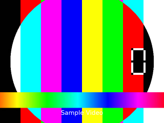

# vivd_windows 的视频播放

`video` 窗口（`types/video_window.gd`）有**两个后端**，按文件后缀自动选，也可以用
`backend` 显式指定：

| 后端 | 解码器 | 支持的格式 | 额外体积 | 渲染器要求 |
|---|---|---|---|---|
| `builtin` | Godot 内置 Theora | `.ogv` | **0 MB** | 任意 |
| `vlc` | LibVLC（godot-vlc 插件） | mp4 / mkv / mov / webm / avi / flv / ts … 几乎万能 | **202 MB**（Windows 运行时） | 任意 |

`auto`（默认）的规则：`.ogv` 走 `builtin`，其余后缀走 `vlc`；插件不在时自动退回
`builtin` 并给出一条明确的报错。

```gdscript
// 播 mp4 —— 自动选中 vlc 后端
VivdWindowsNode.add_window("movie", "video", {
    "video": "res://system_test_1/VID20250306230957.mp4",
    "position": Vector2i(300, 200),
    "size": Vector2i(540, 960),
    "autoplay": true,
    "loop": false,
    "volume_db": -6.0,
    "expand": false,          // false = 等比居中带黑边；true = 铺满拉伸
})

// 播 ogv —— 自动选中 builtin 后端（零依赖）
VivdWindowsNode.add_window("clip", "video", {
    "video": "res://vivd_windows/sample/sample_5s.ogv",
})

// 强制指定
VivdWindowsNode.add_window("w", "video", {"video": "x.mp4", "backend": "vlc"})
```



---

## 结论先说

**本工程现在装的就是 godot-vlc，`.mp4` 直接能播。** 实测（Godot 4.7.2，`gl_compatibility`，
GTX 750，真机窗口）：

```
state -> STOPPED -> OPENING -> PLAYING
is_playing()           = true
get_length()           = 18901 ms
get_time()             = 2286 ms          ← 时间在推进
get_texture()          = ImageTexture 1090x1920
is_gpu_output_active() = false            ← 走软件路径，不碰 RenderingDevice
```

两种 `expand` 都实测截图确认过：`true` 铺满拉伸、`false` 等比居中带黑边。

---

## 装 / 卸 godot-vlc

插件是 [xiSage/godot-vlc](https://github.com/xiSage/godot-vlc)，LGPL-2.1-or-later，
自带上游 LibVLC（用户机器上不需要另外装 VLC）。

```
res://addons/godot-vlc/     ← 解压出来的整个目录
res://.godot/extension_list.cfg
```

**`extension_list.cfg` 是必须的。** Godot 只会加载这个文件里列出的 GDExtension。
编辑器第一次扫描工程时会自动写入，但 `godot --headless --script` 这种非编辑器运行
不会扫描 —— 文件不存在的话扩展**根本不会加载**，你只会看到「类不存在」。
本工程里已经手工写好了：

```
res://addons/godot-vlc/godot_vlc.gdextension
```

**卸载**就是删掉 `addons/godot-vlc/` 并把 `extension_list.cfg` 清空。
`video_window.gd` 用的是 `ClassDB` 动态访问，插件不在时 `.ogv` 照常能播，
`.mp4` 会走内置解码器然后给出一条明确的报错，不会崩、也不会解析失败。

### 体积

| 目录 | 解压后 |
|---|---|
| `bin/win-x64` | **201.7 MB**（其中 `plugins/` 占 187.5 MB） |
| `bin/linux-x64` | 236.5 MB |
| `bin/android-arm64` | 154.4 MB |
| 合计（工程目录） | **592.6 MB** |

> 但**导出时只会打包目标平台那一份** —— `.gdextension` 的 `[libraries]` 和
> `[dependencies]` 是按平台分段的。所以 Windows 玩家的安装包只多 202 MB，
> 不是 592 MB。想再瘦身可以删掉不发布的平台目录（`bin/linux-x64`、
> `bin/android-arm64`），但那样就没法一包多平台了，不建议。

v1.3.0 相比 v1.2 已经剥掉了调试符号：Windows 运行时从 353 MB 降到 71 MB
（指 LibVLC 共享库本身；含 `plugins/` 的整个 `bin/win-x64` 是 201.7 MB）。

---

## 内置 Theora（`builtin`）—— 零依赖那条路

Godot 自带 Theora + Vorbis 解码器，**零插件、零额外体积**，
在 `gl_compatibility` / Forward+ / 移动端 / headless 下都能用。

代价是要把素材转成 `.ogv`：

```bash
ffmpeg -i input.mp4 -c:v libtheora -q:v 7 -c:a libvorbis -q:a 5 output.ogv
```

`-q:v 7` 是画质（0–10）。Theora 是 2004 年的编码，同画质比 H.264 大 2–4 倍，
但它**纯 CPU 解码、无 GPU 互操作**，所以不会碰到驱动/显卡相关的坑。

工程里放了一份 5 秒样例：`sample/sample_5s.ogv`（410 KB）。

**什么时候选它：** 素材本来就不大、或者你想让工程保持零第三方依赖。
一个 45 MB 的 mp4 转 Theora 大概变成 90–140 MB —— 比插件的 202 MB 小，
但要自己动手转码，而且每次换素材都要转。

---

## 为什么不用别的 MP4 插件

三个候选都在 Godot 4.7.2 上实测过，只有 godot-vlc 可用。
记录在这里，免得以后又去踩：

| 方案 | 体积 | 渲染器要求 | 本机实测 |
|---|---|---|---|
| **Godot 内置 Theora** | 0 MB | 任意 | ✅ 稳定 |
| **godot-vlc** | 202 MB | 任意 | ✅ **稳定，本工程在用** |
| `Native Video` | 1.7 MB | Forward+ / Mobile | ❌ 崩溃 / 挂死 |
| `EIRTeam.FFmpeg` | 10.3 MB | Forward+ / Mobile | ❌ 不崩，但画面全空 |

### `Native Video`：崩溃

[claytercek/Native Video](https://store.godotengine.org/asset/claytercek/native-video/)
体积只有 1.7 MB，用系统解码器硬解 H.264/HEVC。**但在这台机器上会崩。**

用**裸 `VideoStreamPlayer`**（不经过 vivd_windows）反复实测：

| 版本 | 素材 | 结果 |
|---|---|---|
| v0.3.1（Zig） | 64×64 一秒钟短片（中文路径工程） | 成功 3 / **崩溃 3** |
| v0.3.1（Zig） | 同上，**ASCII 路径**对照工程 | 成功 0 / **崩溃 8** |
| v0.3.1（Zig） | 真实 1 MB mp4（640×360，101 秒） | 成功 5 / **崩溃 1** |
| v0.2.1（C++ 版） | 真实 1 MB mp4 | 成功 0 / **挂死 8** |

崩溃是插件侧 Zig 的 `panic: sentinel mismatch`，固定发生在 `player.stream = media`
（解码器初始化）。换成 Vulkan 一样崩，所以不是 D3D12 专属问题。

排查过、已排除：❌ 中文路径（纯 ASCII 对照工程崩得更彻底）❌ vivd_windows 的代码
（裸 `VideoStreamPlayer` 复现）❌ 渲染器选错。很可能是老 GPU / 远程显示下的解码器
初始化问题，换机器可能就好了。

### `EIRTeam.FFmpeg`：不崩，但画面全空

[EIRTeam.FFmpeg](https://github.com/EIRTeam/EIRTeam.FFmpeg)（10.3 MB）解码、播放、
计时全都正常，**但画面出不来**，每一帧都在刷：

```
ERROR: This compute pipeline requires (4) bytes of push constant data, supplied: (16)
```

**根因**：它用 GPU 计算着色器做 YUV→RGB。源码 `ffmpeg_video_stream.cpp:284`：

```cpp
if (frame_format == YUV420P || frame_format == YUVA420P) {
    yuv_converter.instantiate();        // ← YUVGPUConverter：RenderingDevice 计算着色器
} else {
    texture = ImageTexture::create_from_image(...);   // ← 纯 CPU 路径
}
```

H.264/MP4 几乎永远是 YUV420P，所以正常视频 100% 走 GPU 那条路。这个 build 的
push constant 布局和 **Godot 4.7 的 RenderingDevice 校验不兼容**，dispatch 全部失败
→ 输出纹理永远是空的。这种失败最阴险：只有盯着屏幕才发现是黑屏。

> **这两个插件的共同点：都依赖 `RenderingDevice`。** 这不是巧合 —— H.264 基本
> 都是 YUV420P，现代插件几乎都用 GPU 计算着色器做 YUV→RGB 转换。而 godot-vlc
> 默认走**软件解码 + vmem 输出**（`force_hardware=false`），完全不碰
> `RenderingDevice`，所以它在 `gl_compatibility` 下也能跑 —— 这对「考虑玩家的设备」
> 是有实际意义的：`gl_compatibility` 只要 OpenGL 3.3，覆盖面比要求 Vulkan/D3D12 的
> Forward+ 宽得多。

---

## 实现上的三个坑

前两个是 godot-vlc 自己文档里写过的，第三个是实测撞出来的。**都真的踩了。**

### 1. 不能在 GDScript 里写 `VLCMediaPlayer` 这个类名

GDScript 是在**工程导入期**解析的，那一刻 GDExtension 还没注册任何类，写类名会变成
解析错误 —— 而且是那种会把整个脚本从导出工程里一并干掉的错误
（插件作者就是因为这个 bug 发了 v1.3.0）。

所以 `video_window.gd` 里一律用 `ClassDB.class_exists()` / `ClassDB.instantiate()`
加 `Object.call()` / `set()` / `get()` 动态访问。副作用是好的：没装插件时这套代码
照样解析得了、跑得起来。

### 2. 不能指望 `load("res://x.mp4")`

插件的自定义 `ResourceFormatLoader`（`addons/godot-vlc/format_loader.gd`）只在
**编辑器扫描过工程之后**才注册。非编辑器运行拿不到，`load()` 返回 `null` 并刷一条
`ERROR: No loader found for resource`。

所以加载顺序是：

1. 先用 `ResourceLoader.get_recognized_extensions_for_type("VLCMedia")` 问 loader
   在不在；在就走 `load(path)` —— **导出后资源被打进 PCK 时，只有这条路能读到**。
2. 不在就退到 `VLCInstance.load_media_file()` + `ProjectSettings.globalize_path(path)`。

### 3. `VLCMediaPlayer` 本身就是个 `Control`

它自己会把自己画在窗口里，**不需要再套一个 `TextureRect`**。
`get_texture()` 能拿到当前帧（`stretch_mode` 控制缩放方式）。

### 4. 窗口关掉时不能让播放器跟着一起 `free`（**会 abort 整个进程**）

这条最凶险，因为它**偶发**。

```
ERROR: [panic godot-core-0.5.5/src/classes/class_runtime.rs:379]
  AudioStreamPlayer::upcast_ref: access to instance with ID 91368720359
  after it has been freed
thread caused non-unwinding panic. aborting.
```

**根因**：libvlc 的音频/解码回调跑在**它自己的线程**上，而 Godot 释放节点是
**先释放子节点、后释放父节点**。插件内部挂着一个 `AudioStreamPlayer` 当音频出口，
窗口一 `queue_free`，那个子节点就先没了 —— 可 libvlc 的线程这时还在回调。
回调到已释放的对象上，godot-rust 直接 `abort()`，**不是抛异常，整个进程没了**。

这是 **godot-vlc v1.3.0 的 use-after-free**。作者在 master 上给回调加了
`is_instance_valid` 检查（他仓库里 `demo/tests/player_teardown.gd` 的注释写的就是这个
问题），但那版还没发 release。

**本工程的规避**（`types/video_window.gd` 的 `teardown()` / `_retire()`）：
窗口被移除时，先 `set_pause(true)` 让音频线程停住、再 `stop_async()`，然后把播放器
**从窗口里摘出来藏到场景根上**（`visible = false`），隔 `VLC_DRAIN_SECONDS`（0.5 秒）
再 `queue_free()` —— 让它比窗口多活几帧，等 libvlc 的线程安静下来。

**在 headless 下特别容易触发**：Godot 的假音频驱动没人消费音频，libvlc 会疯狂刷
`godot-vlc: audio buffer full`，回调频率高得离谱，竞态窗口被撑得很大。
冒烟测试里那条「移除 playing 中的 VLC 窗口不崩」就是用来钉这个回归的。
所以 `vivd_smoke_test.gd` 在 `quit()` 之前还多等 1 秒，给延后回收留时间。

> 在真实（非 headless）运行里这条窗口小得多，但**不是零**。如果你哪天升级到把
> `is_instance_valid` 检查发出来的版本，这段规避就可以撤掉了。

---

## v1.3.0 的 API 备忘

从 `ClassDB` 实地 dump 出来的（不是猜的）：

```gdscript
# 加载
VLCInstance.load_media_file(path) -> VLCMedia     # Engine.get_singleton(&"VLCInstance")
VLCMedia.load_from_file(path)                     # 静态；绝对路径
VLCMedia.load_from_mrl(mrl)

# 播放器（extends Control）
player.media = media        player.autoplay = false
player.force_hardware = false                     # 默认；true 才走 D3D11 GPU 路径
player.stretch_mode = 0     player.volume_db = -6.0
player.bus = &"Master"      player.mix_target = 0

player.play()               player.pause()        player.set_pause(true)
player.stop_async()         player.get_state()    player.is_playing()
player.get_time()           player.get_length()   player.set_time(ms, fast)
player.get_position()       player.set_position(p, fast)
player.get_rate()           player.set_rate(r)
player.get_texture()        player.is_gpu_output_active()

# 信号
stopped  playing  paused  buffering  opening  video_frame  stopping

# 常量
STATE_PLAYING = 3   STATE_PAUSED = 4
```

**没有的：**`loop` 属性、`set_abloop_*`（`demo/tests/ab_loop.gd` 是 master 分支的
新功能，v1.3.0 里还没有）、`VLCMediaList` / `VLCSubtitle` / `VLCPicture` /
`VLCThumbnail`（这些类没注册，应该是编辑器/特性门控的）。

所以 `loop` 是这么实现的：接 `stopped` 信号，用一个 `_user_stop` 标志区分
「用户主动 stop」和「自然播完」，自然播完且 `loop` 为真就再 `play()` 一次。

---

## 排查

| 现象 | 原因 |
|---|---|
| `ClassDB 无法实例化 VLCMediaPlayer` | 扩展没加载。检查 `.godot/extension_list.cfg` 里有没有那行路径 |
| `VLCInstance 单例不存在` | 同上，扩展加载失败 |
| `VLC 加载失败：xxx.mp4` | 文件路径不对，或者文件被 PCK 打包后 loader 又没注册 |
| `视频加载失败：xxx.mp4` + `load()` 返回 null | 走的是 builtin 后端且没有解码器认这个格式 |
| `不是 VideoStream（得到 ...）` | 强制 `backend=builtin` 播了 mp4。这是预期行为 |
| 窗口全黑但有声音 | 解码器没能给出纹理；看播放器日志 |
| 进程突然 `abort`，日志里有 `AudioStreamPlayer::upcast_ref: … after it has been freed` | godot-vlc v1.3.0 的 use-after-free。本工程已在 `teardown()` 里规避，详见「实现上的三个坑」第 4 条 |
| 满屏 `godot-vlc: audio buffer full` | **只在 `--headless` 下出现**，是 Godot 的假音频驱动没人消费音频。窗口模式正常，可以忽略。顺带说一句：这玩意儿会显著放大上面那条竞态 |
| 换了解码器插件后扩展没加载 | 必须在编辑器里打开一次工程，或手工写 `.godot/extension_list.cfg` |
| 想确认当前认哪些扩展名 | `ResourceLoader.get_recognized_extensions_for_type("VideoStream")` / `("VLCMedia")` |

[VideoStreamPlayer]: https://docs.godotengine.org/en/stable/classes/class_videostreamplayer.html
[VideoStream]: https://docs.godotengine.org/en/stable/classes/class_videostream.html
